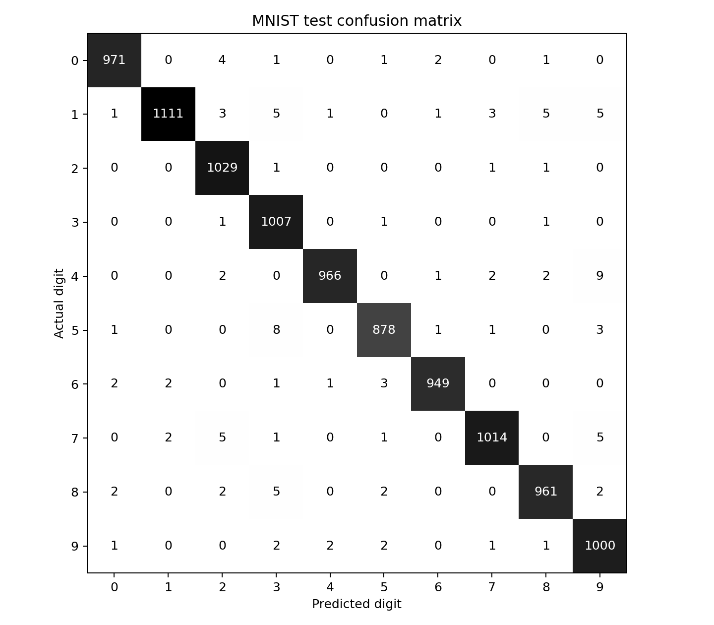
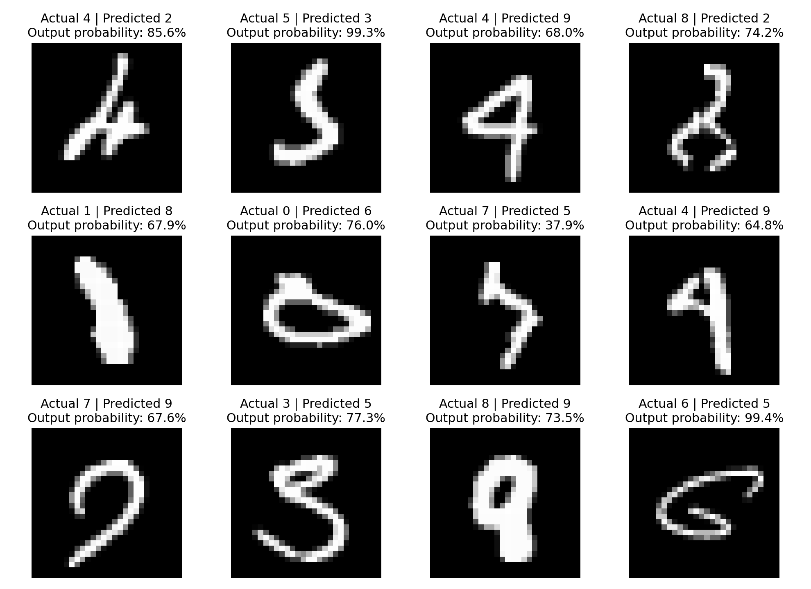

# Preprocessing and evaluation

**Contribution: Muhammadh Azwardeen**

## Method

We restored the selected CNN without retraining. Its input shape is
`(None, 28, 28, 1)`, its output shape is `(None, 10)`, and it has 421,642
parameters. Recreating the same architecture before loading its trained weights
avoids initializer-configuration differences between Keras versions.

MNIST contains 60,000 original training images and a separate 10,000-image test
set. We reproduced the stratified 50,000/10,000 training and validation split
using `random_state=42`. We converted raw uint8 pixels to float32, divided by
255 and added one grayscale channel. Preprocessing always starts from the raw
images, so rerunning it does not repeatedly divide prepared values.

The selected model returned ten probabilities per test image. We selected the
largest with `argmax` and calculated accuracy, per-class precision, recall, F1
and a confusion matrix. Macro averages give each digit equal weight; weighted
averages account for the number of test examples belonging to each digit.

## Results

The supplied checkpoint gives 98.86% test accuracy: 9,886 correct predictions and
114 errors from 10,000 images. Macro F1 is 0.9886. Digit 6 has the highest F1
(0.9927), and digit 9 has the lowest (0.9838).

The most frequent mistakes are actual 4 predicted as 9 (nine cases), followed by
actual 5 predicted as 3 (eight cases). The first 12 errors are displayed with
their actual labels, predictions and predicted-class probabilities. An actual 5
is predicted as 3 with approximately 99.3% output probability, illustrating that
high confidence does not guarantee correctness.

Both accuracy and all 100 confusion-matrix counts match the supplied reference
files. These aggregate checks do not compare the probabilities of every image.

## Saved work

The notebook is `notebooks/04_preprocessing_and_evaluation.ipynb`. Reusable
functions are in `src/section3_evaluation.py`. Its four numerical exports and two
figures are saved separately in `results/section3/`, leaving the training
reference results unchanged. The summary records the checkpoint SHA-256 so the
evaluated model can be identified.

## Limits

The results apply to the official MNIST test set. Only the first 12 errors were
visually inspected, and similar-looking handwriting is a possible explanation,
not proof of which pixels caused the model's decision. Neither these examples
nor classification accuracy establish explanation quality, probability
calibration or adversarial robustness. No augmentation or retraining is performed
by Section 3.

## References

- [Keras MNIST dataset](https://keras.io/api/datasets/mnist/)
- [scikit-learn classification report](https://scikit-learn.org/stable/modules/generated/sklearn.metrics.classification_report.html)
- [scikit-learn confusion matrix](https://scikit-learn.org/stable/modules/generated/sklearn.metrics.confusion_matrix.html)
